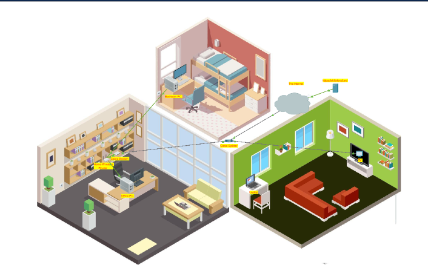
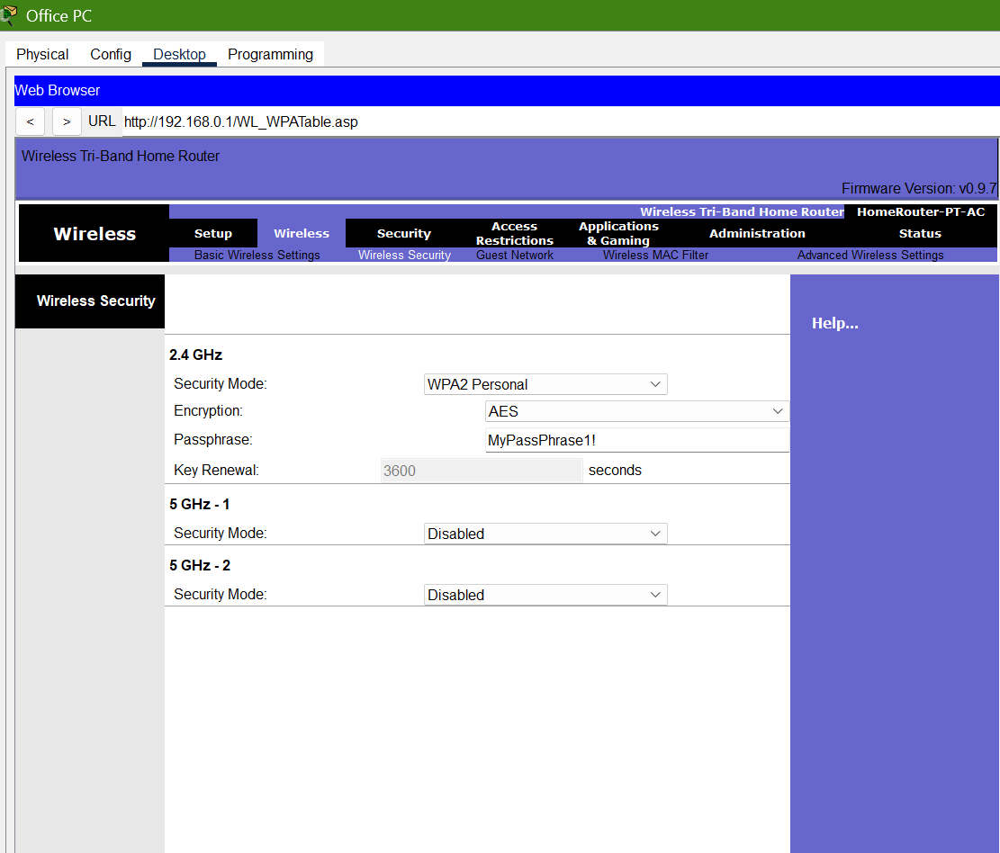
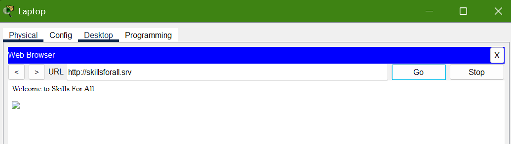
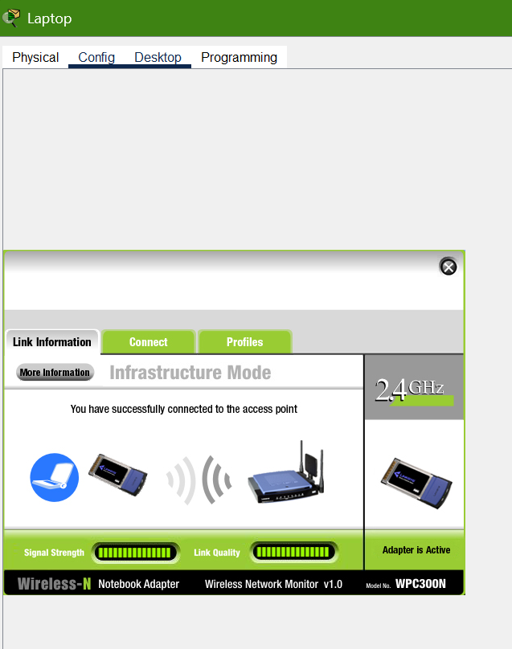

# Lab 01: Configure a Wireless Router and Clients

A Cisco Packet Tracer lab from Cisco Networking Academy. I set up a small home network from scratch: cabling the devices, configuring a wireless router, and checking that wired and wireless devices can reach the internet.

## What I built

A home network with a cable modem, a home wireless router, two wired PCs (office and bedroom) and a wireless laptop, connected to the internet through a cable TV provider.

## Skills shown

- Choosing and connecting the correct cable types (coaxial and copper straight-through)
- Configuring a home wireless router through its web interface
- Setting up DHCP so devices receive IP addresses automatically
- Securing a wireless network with WPA2 Personal
- Testing and troubleshooting connectivity from wired and wireless clients

## What I did

### Part 1: Connect the devices
- Connected the coaxial cabling so the internet service reached the cable modem and the TV service reached the television.
- Connected the cable modem to the router's internet port and linked both PCs to the router's wired ports with straight-through cables.

### Part 2: Configure the router
- Found the router's address (the default gateway) from the PC's DHCP settings and opened its web interface in the browser.
- Limited the DHCP pool to 10 users, since the home only has a few devices.
- Replaced the default administrator password. Default credentials are publicly known, so changing them is one of the first things to do on a new router.
- Enabled the 2.4 GHz wireless network, renamed it from the default SSID, and secured it with WPA2 Personal and a passphrase.

### Part 3: Test connectivity
- Connected the laptop to the new wireless network and confirmed it received an IP address from the router.
- Set the bedroom PC to DHCP and confirmed its address.
- Confirmed that the laptop, office PC and bedroom PC could all open the test website, which shows internet access works for both wired and wireless clients.

## Screenshots

Add your own screenshots to the `screenshots` folder and link them here, for example:

## What I learned

- A router can do several jobs at once: it gives out IP addresses (DHCP), joins wired and wireless devices into one network, and connects that network to the internet.
- A new device should never keep its default password, and wireless networks should always use encryption such as WPA2.
- When something doesn't connect, check the basics first: the cables, then whether the device received an IP address, then the router settings.

## Files

- `configure-wireless-router.pka`: the Packet Tracer activity file (open it with Cisco Packet Tracer)

## Tools

Cisco Packet Tracer · Cisco Networking Academy
